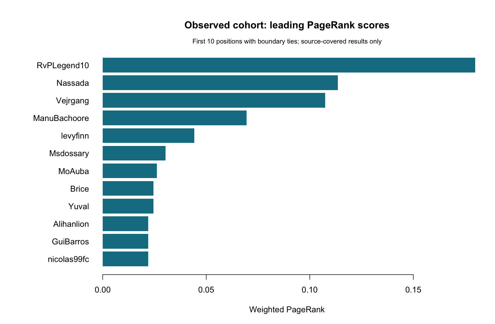

# Who Really Beats Whom

A reproducible R project for the head-to-head network of competitive FIFA / EA Sports FC players. The current milestone is **November 6, 2026**: clean data, build win/played networks, describe the network, and address PageRank ranking (RQ1). The two-page progress report is dated November 6.

**Current evidence:** 129 verified fixtures and 81 players across all 9 editions. Live, explicitly provider-recorded career and edition earnings now support RQ1 comparisons, and 51 world/major versus 78 domestic fixtures support a sensitivity run. Sampling and earnings coverage remain incomplete. See [coverage](docs/data-coverage.md), [the report](reports/mid-project-report.md), and [availability](results/availability.csv).

## Run it

From this repository's root, with R 4.4 or later:

```sh
Rscript scripts/setup.R
Rscript scripts/test.R
Rscript scripts/run_pipeline.R
```

The analysis uses base R and igraph; jsonlite supports the prepared earnings API client. The checked-in cohort runs offline. The environment used for the saved results is recorded in [the run manifest](results/run-manifest.csv) and [session information](results/session-info.txt). `setup.R` installs missing dependencies from CRAN; it does not pin or downgrade installed versions.

Read the [mid-project report](reports/mid-project-report.md), [metrics](results/metrics.csv), [rankings](results/rankings.csv), and [correlation availability](results/correlations.csv). Figures are under `results/figures/`; GraphML and edge lists are under `results/graphs/`.



## What is implemented

- CSV validation with provenance, stable IDs, score/decision checks, duplicate rejection, explicit date precision, and a cutoff. Invalid data stops analysis after a quality report is written.
- Weighted directed win networks (loser → winner), undirected played networks, pooled and edition scopes, descriptive metrics and degree distributions. Completed draws enter the played network only.
- Weighted PageRank, wins and correctly scoped earnings rank comparisons, with explicit missing-data statuses and ties handled consistently.
- Seeded G(n,m) reference networks and an executed world/major-versus-domestic sensitivity run, using documented research event-scope categories.
- Attributed public records and a generated mid-project report. Test fixtures are separate from empirical data.
- Cached, throttled Esports Earnings API preparation with a no-network dry run and tested cache-to-CSV normalization. Approved Liquipedia export ingestion is documented; no unsupported LPDB endpoint is invented.

## Add data

Review [the data dictionary](docs/data-dictionary.md) and [API access instructions](docs/api-access.md). Create local `data/input/matches.csv`, `players.csv`, and `earnings.csv` using the headers in `data/examples/`, then run:

```sh
Rscript scripts/run_pipeline.R --input-dir=data/input
```

Custom-input outputs default to ignored `data/input/analysis/`, preserving the public result snapshot. `--output-dir=DIR` overrides the base output directory. `--cutoff=YYYY-MM-DD` overrides the analysis cutoff. The canonical file named `earnings.csv` may contain only its header while earnings are unavailable. API JSON exports can now be normalized with `scripts/normalize_earnings.R` using reviewed identity and game maps; see the access instructions.

```sh
Rscript scripts/fetch_api.R
```

This prints the earnings request plan without reading credentials or accessing the network. Live calls require a reviewed local job file, a local environment key and `--live`. Never commit keys, private exports, or unreviewed raw API payloads. Do not request keys through repository issues.

## Structure and remaining work

| Location | Purpose |
| --- | --- |
| `R/` | Validation, network analysis, report/figure generation, API client |
| `scripts/` | Setup, pipeline, API fetch, and tests |
| `data/raw/` | Attributed, manually curated public records and source register |
| `data/clean/` | Validated CSVs generated from the public records |
| `data/examples/` | Empty canonical schema templates |
| `config/` | Cutoff, editions, major-tier definitions, example API jobs |
| `results/` | Saved tables, graphs, figures, and environment manifest |
| `reports/` | Final two-page progress report and generated analysis notes |
| `docs/` | Data dictionary, sources/coverage, access instructions, timeline |
| `tests/` | Meaningful validation, graph, ranking, and mocked API checks |

The [timeline](docs/timeline.md) distinguishes completed infrastructure from missing empirical work. All nine editions have observations, and career/edition earnings joins now run. Full historical coverage, unresolved identities, placement comparisons and competitive-region attributes remain work to complete. RQ2–RQ4 are scheduled November 7–20, RQ5 November 21–27, and final writing/video November 28–December 2. No submission, application or collaborator message was sent.

No code reuse license has been selected; see `LICENSE`. Any future Liquipedia educational-access application must satisfy its then-current open-source and attribution conditions before collection.

The submission manuscript in `reports/mid-project-report.md` is frozen to the November 6 evidence snapshot and follows the four-question, two-page assignment rubric. Pipeline runs write `reports/analysis-notes.md` so they do not overwrite the finalized manuscript. `reports/build_submission.py` creates an editable Word document using python-docx; render it to PDF for submission. The report retains sampling and earnings limitations.
