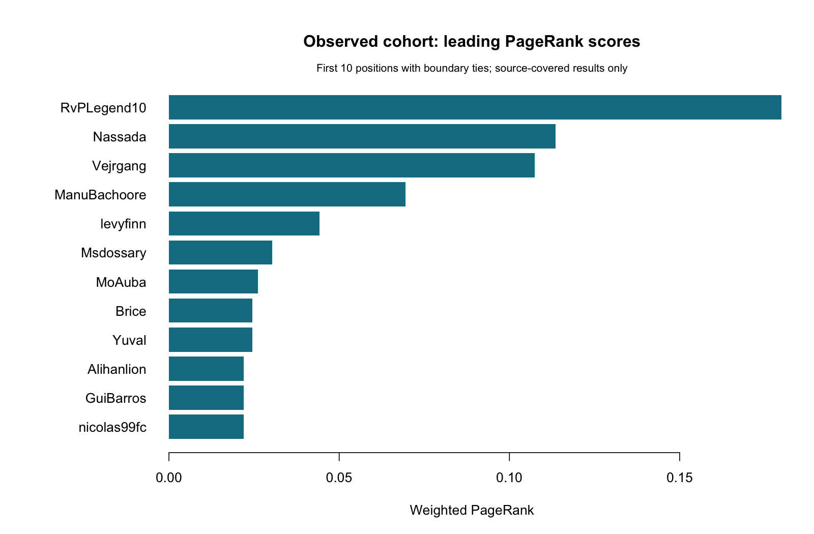
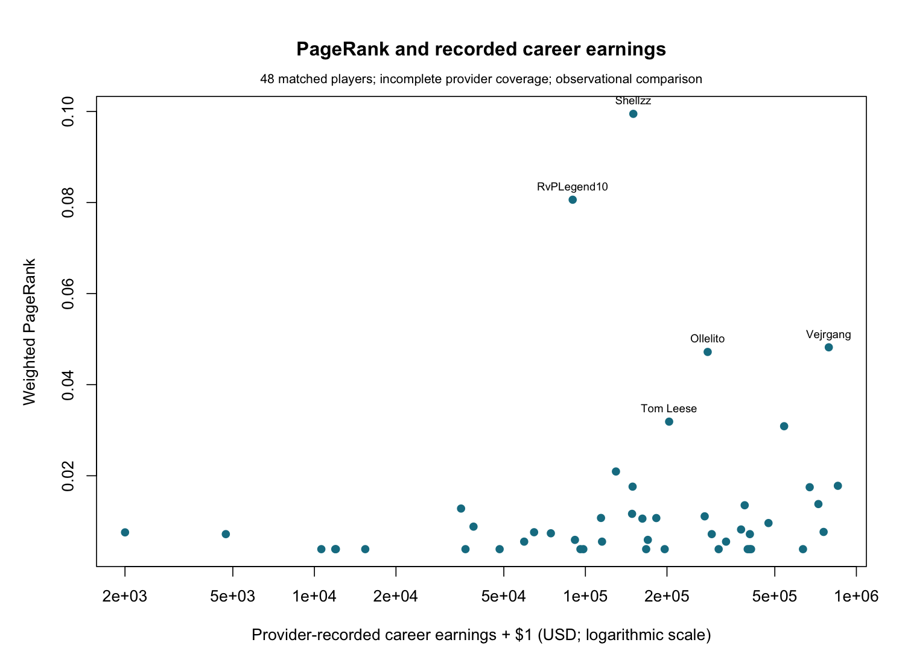
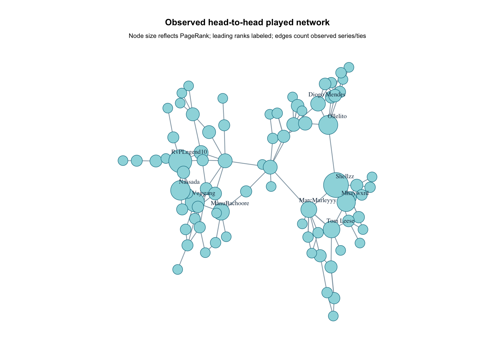
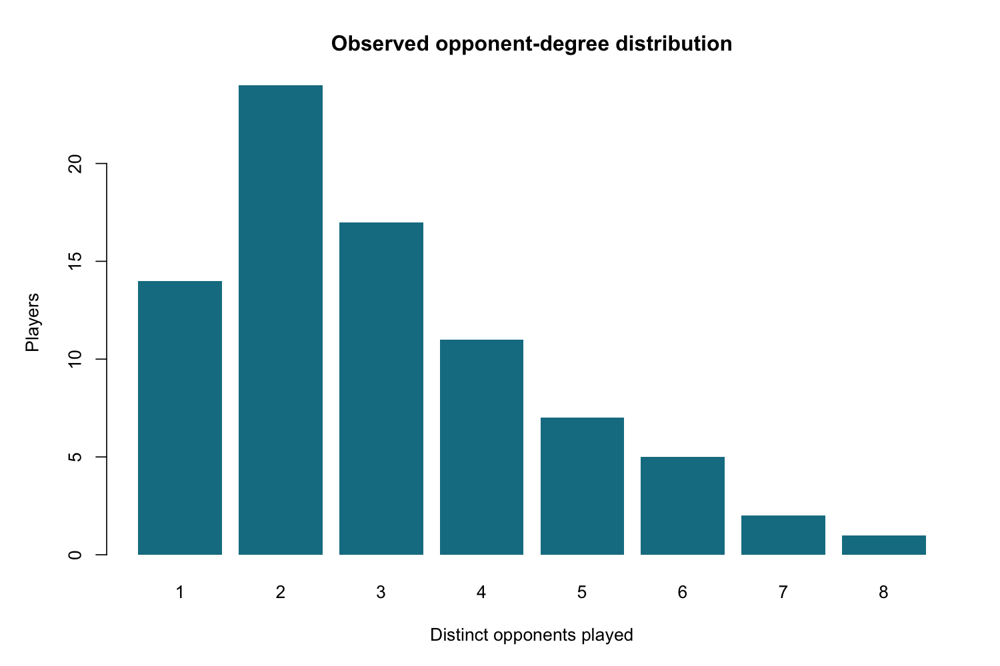

# Competitive FIFA analysis notes

Evidence cutoff: **2026-11-06** (America/Vancouver). Report due **November 6, 2026**. Research draft; not submitted.

## Results and current status

The R workflow validates 129 source-backed head-to-head fixtures involving 81 players across 9 of 9 proposed editions. Input: checked-in public cohort. Official world, continental and domestic events are represented. All editions having observations does not imply complete historical coverage.

Within the observed combined network, **Shellzz** has the largest weighted PageRank. This is a sample-dependent ranking, affected by event selection, bracket progression and unequal coverage across editions; it cannot establish the strongest professional globally.

RQ1's combined comparison with provider-recorded career earnings now computes: **Spearman rho = 0.2871**, using **48 matched players**. Provider totals are incomplete observations, not verified complete actual career earnings. The per-edition comparison statuses are reported below.

## Availability and data quality

| feature | status | evidence |
| --- | --- | --- |
| edition_observations | available | 9/9 editions represented; not complete populations |
| career_earnings_comparison | available | 48 matched players; provider-recorded totals |
| edition_earnings_comparisons | available | 9/9 edition comparisons have >=3 nonconstant matched pairs |
| event_scope_sensitivity | available | 51 world/major and 78 domestic fixtures; research classification |
| country_attributes | partial | 50/81 active players with sourced country codes |
| exact_match_dates | partial | 95/129 exact days; remaining event-end bounds preserved |
| full_historical_corpus | partial | Selective official-event cohort; all editions represented does not imply complete coverage |
| LPDB_live_collection | requires_approved_access | Offline approved-export path and earnings normalization work; no Liquipedia credential supplied |

| game_edition | matches |
| --- | --- |
| FIFA18 | 2 |
| FIFA19 | 2 |
| FIFA20 | 7 |
| FIFA21 | 71 |
| FIFA22 | 3 |
| FIFA23 | 3 |
| FC24 | 7 |
| FC25 | 11 |
| FC26 | 23 |

The input includes 48 career and 222 edition earnings snapshots. Of the combined network's 81 players, 48 have matched career measurements. Unlisted player/game observations remain missing, never zero. 34 fixtures retain unknown exact match days and use sourced event-end bounds only for cutoff eligibility.

Validation recorded 0 errors, 0 exclusion notices and 34 uncertainty warnings. Counts refer to notices rather than necessarily distinct rows. Clean CSVs preserve IDs and sources; results/quality-issues.csv records the notices.

The earnings estimand is now explicitly the amount the provider reports at retrieval. Earlier exclusions treated incomplete profiles as unusable for any comparison. That was unnecessarily restrictive for a comparison with provider-recorded totals. The revised analysis does not claim that missing tournaments have been repaired, add known prizes onto potentially overlapping totals, or backdate November 6 observations into the November 4 snapshot. See docs/earnings-provenance.md for retrieval evidence, aliases and identity exclusions.

## Network construction and descriptive metrics

One completed source-listed 1v1 bracket fixture or series contributes one played-edge unit; historical multi-leg ties count once as aggregate series. A decisive fixture creates a loser-to-winner edge. Repeated opponents accumulate edge weight. Completed draws enter the played network only. Penalty winners are explicit; shootout scores are not goal totals. Only participating players enter a scope. Combined and edition networks are exported as GraphML and edge CSVs.

| scope | nodes | matches | win_edges | played_edges | density_played | mean_degree_played | components_played | giant_component_fraction |
| --- | --- | --- | --- | --- | --- | --- | --- | --- |
| combined | 81 | 129 | 124 | 122 | 0.0377 | 3.0123 | 1 | 1 |
| FC24 | 8 | 7 | 7 | 7 | 0.2500 | 1.7500 | 1 | 1 |
| FC25 | 12 | 11 | 11 | 11 | 0.1667 | 1.8333 | 1 | 1 |
| FC26 | 24 | 23 | 23 | 23 | 0.0833 | 1.9167 | 1 | 1 |
| FIFA18 | 3 | 2 | 2 | 2 | 0.6667 | 1.3333 | 1 | 1 |
| FIFA19 | 3 | 2 | 2 | 2 | 0.6667 | 1.3333 | 1 | 1 |
| FIFA20 | 8 | 7 | 7 | 7 | 0.2500 | 1.7500 | 1 | 1 |
| FIFA21 | 40 | 71 | 67 | 65 | 0.0833 | 3.2500 | 1 | 1 |
| FIFA22 | 4 | 3 | 3 | 3 | 0.5000 | 1.5000 | 1 | 1 |
| FIFA23 | 4 | 3 | 3 | 3 | 0.5000 | 1.5000 | 1 | 1 |

In-degree counts distinct opponents beaten, incoming strength counts won fixtures, played degree counts distinct opponents, and played strength counts fixtures. Low degree can reflect knockout format and omitted stages; it does not alone demonstrate regional isolation.

## RQ1: rankings and recorded earnings

Weighted PageRank uses damping 0.85. Average ranks handle ties after scores are rounded to 12 significant digits for ranking/correlation only; raw PageRank is retained. Negative rank gaps indicate a better PageRank position than the comparison rank. Earnings rank gaps use the identical matched player subset. Combined graphs use career totals; edition graphs use only the corresponding game's reported totals. Each snapshot must be dated no later than the cutoff.

| handle | pagerank_rank | pagerank | wins | losses | opponents |
| --- | --- | --- | --- | --- | --- |
| Shellzz | 1 | 0.0995 | 6 | 0 | 6 |
| RvPLegend10 | 2 | 0.0806 | 5 | 0 | 5 |
| Nassada | 3 | 0.0511 | 2 | 1 | 3 |
| Vejrgang | 4 | 0.0482 | 5 | 1 | 6 |
| Ollelito | 5 | 0.0472 | 5 | 1 | 6 |
| Mhaywxrd | 6 | 0.0427 | 4 | 1 | 5 |
| Tom Leese | 7 | 0.0319 | 6 | 1 | 6 |
| ManuBachoore | 8 | 0.0309 | 5 | 1 | 6 |
| MarcMarleyyy | 9 | 0.0271 | 6 | 3 | 7 |
| Diogo Mendes | 10 | 0.0209 | 4 | 1 | 5 |

| scope | comparison | n_complete | spearman_rho | status |
| --- | --- | --- | --- | --- |
| combined | pagerank_vs_wins | 81 | 0.9700 | computed |
| combined | pagerank_vs_earnings | 48 | 0.2871 | computed |
| FC24 | pagerank_vs_wins | 8 | 1.0000 | computed |
| FC24 | pagerank_vs_earnings | 7 | 0.4335 | computed |
| FC25 | pagerank_vs_wins | 12 | 0.9920 | computed |
| FC25 | pagerank_vs_earnings | 11 | -0.1151 | computed |
| FC26 | pagerank_vs_wins | 24 | 0.9795 | computed |
| FC26 | pagerank_vs_earnings | 4 | -0.3162 | computed |
| FIFA18 | pagerank_vs_wins | 3 | 1.0000 | computed |
| FIFA18 | pagerank_vs_earnings | 3 | 0.8660 | computed |
| FIFA19 | pagerank_vs_wins | 3 | 1.0000 | computed |
| FIFA19 | pagerank_vs_earnings | 3 | 0.8660 | computed |
| FIFA20 | pagerank_vs_wins | 8 | 1.0000 | computed |
| FIFA20 | pagerank_vs_earnings | 4 | 0.7379 | computed |
| FIFA21 | pagerank_vs_wins | 40 | 0.9728 | computed |
| FIFA21 | pagerank_vs_earnings | 10 | 0.5030 | computed |
| FIFA22 | pagerank_vs_wins | 4 | 0.7778 | computed |
| FIFA22 | pagerank_vs_earnings | 4 | 0.9487 | computed |
| FIFA23 | pagerank_vs_wins | 4 | 1.0000 | computed |
| FIFA23 | pagerank_vs_earnings | 4 | 0.6325 | computed |

Largest absolute differences between PageRank and provider-recorded career-earnings ranks (within the matched subset):

| handle | earnings_usd | pagerank_rank_earnings_subset | earnings_rank | pagerank_minus_earnings_rank |
| --- | --- | --- | --- | --- |
| PHzin | 635235.02 | 41 | 6 | 35 |
| RvPLegend10 | 89762.63 | 2 | 35 | -33 |
| Neat | 408545.17 | 41 | 9 | 32 |
| Gorilla | 404021.96 | 41 | 11 | 30 |
| Brice | 34765.66 | 13 | 42 | -29 |
| Emre Yilmaz | 397149.98 | 41 | 12 | 29 |
| Obrun2002 | 310295.46 | 41 | 16 | 25 |
| Shellzz | 150258.94 | 1 | 26 | -25 |
| Samugamer | 2000.00 | 24 | 48 | -24 |
| Diogo Mendes | 129640.49 | 7 | 29 | -22 |

Career totals may include games or competition formats absent from this 1v1 network. Provider pages omit known tournaments, and players with recorded earnings are not a random subset. Edition totals are separate measurements and absent game rows are not inferred as zero. Correlations describe the observed data; no causal interpretation or statistical-significance claim is made.

## Event-scope sensitivity and random reference graphs

Event-scope sensitivity: World/major subset exported with common-player rank comparisons (51 of 129 fixtures retained).

`research_event_scope_v1` classifies world championships as world, the international eChampions League as major, and domestic ePremier League events as regional. These are research categories, not official or Liquipedia tier labels. The world/major subset, full-sample comparison ranks and correlations are exported under results/major-tier-sensitivity/. Rank changes are calculated on the same shared players, so simply removing players does not mechanically improve everyone else's comparison rank. Since domestic records are concentrated in FIFA20/21, this sensitivity also changes edition coverage; it cannot isolate a pure tournament-tier effect. Small cups and open qualifiers remain underrepresented.

For each scope, 100 seeded undirected G(n,m) graphs retain the observed player and played-edge counts. Density and mean degree match by construction, so comparison uses giant-component fraction and global transitivity. Simulation 2.5%–97.5% intervals are null-model reference ranges, not population confidence intervals. Undefined transitivity is retained as undefined, with finite replicate counts exported.

| scope | observed_giant_fraction | random_giant_mean | random_giant_q025 | random_giant_q975 | observed_transitivity | random_transitivity_mean |
| --- | --- | --- | --- | --- | --- | --- |
| combined | 1 | 0.9538 | 0.9071 | 0.9877 | 0.1517 | 0.0377 |
| FC24 | 1 | 0.8638 | 0.6250 | 1.0000 | 0.0000 | 0.1625 |
| FC25 | 1 | 0.8192 | 0.5833 | 0.9604 | 0.0000 | 0.1524 |
| FC26 | 1 | 0.7904 | 0.6250 | 0.9167 | 0.0000 | 0.0605 |
| FIFA18 | 1 | 1.0000 | 1.0000 | 1.0000 | 0.0000 | 0.0000 |
| FIFA19 | 1 | 1.0000 | 1.0000 | 1.0000 | 0.0000 | 0.0000 |
| FIFA20 | 1 | 0.8538 | 0.6250 | 1.0000 | 0.0000 | 0.1725 |
| FIFA21 | 1 | 0.9638 | 0.9000 | 1.0000 | 0.2601 | 0.0820 |
| FIFA22 | 1 | 0.9600 | 0.7500 | 1.0000 | 0.0000 | 0.1600 |
| FIFA23 | 1 | 0.9400 | 0.7500 | 1.0000 | 0.0000 | 0.2400 |

## Figures and reproducibility

Run `Rscript scripts/run_pipeline.R` from the repository root and `Rscript scripts/test.R` for checks. The default run is offline. API cache normalization is executable through scripts/normalize_earnings.R; live earnings requests still require a local key. Approved Liquipedia exports can use the canonical CSV path. results/run-manifest.csv records the cutoff, input hashes and dependency versions; results/session-info.txt records the R environment.

## Remaining work

Broader event collection and identity audits remain necessary for global conclusions. Platform and country provenance have been improved, but competitive qualifying region must be sourced separately; a country flag is not proof of a player's circuit region. Tournament-placement comparisons are not implemented yet. API access credentials and an approved LPDB schema remain external prerequisites for large-scale collection, not for reproducing the checked-in results.

The November 6 deliverable contains descriptive analysis and RQ1 results with explicit sampling limits. November 7–20 covers communities/assortativity (RQ2), triads (RQ3) and bridges (RQ4); November 21–27 covers robustness (RQ5); November 28–December 2 covers the final report and video, for the December 3 presentation. No submission or access application was sent.

## Sources

Match evidence: data/raw/sources.csv, data/raw/match_sources_expansion.csv and docs/match-expansion.md. Earnings snapshots and identity decisions: data/raw/earnings_sources.csv and docs/earnings-provenance.md. Event classifications and platform sources: data/raw/tournaments.csv. These registers link the official competition reports and provider profiles used by each record.

Methods and access documentation: [igraph PageRank](https://r.igraph.org/reference/page_rank.html), [Esports Earnings API](https://www.esportsearnings.com/apidocs), [Liquipedia API](https://liquipedia.net/api) and [API terms](https://liquipedia.net/api-terms-of-use).
