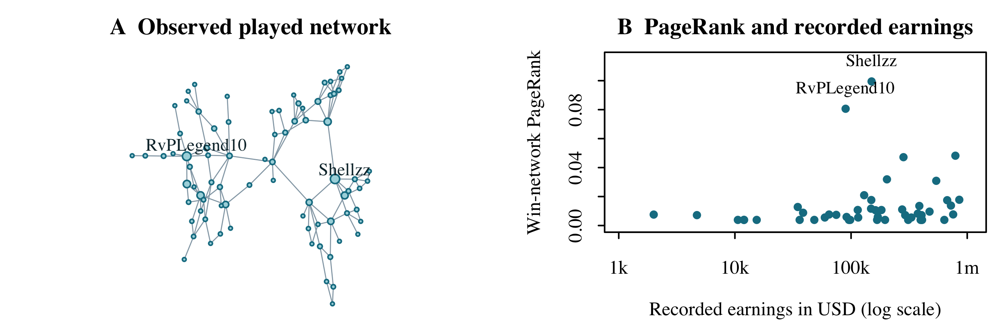

# Competitive FIFA Head to Head Network

Network Science Progress Report  6 November 2026

Group members: Frank Williams and AbdulHaady Oludare

Private repository: [github.com/frankwilz/fifa-head-to-head](https://github.com/frankwilz/fifa-head-to-head)

## 1 Work completed

We validated 129 1v1 fixtures for 81 players across FIFA 18 to EA Sports FC 26 and built pooled and per-edition weighted networks. Win links point from loser to winner; played links are undirected. We calculated degree, density, components and PageRank on the win network (damping 0.85) [1].

With approved Liquipedia access unavailable, we curated official EA, FIFA, UEFA and Premier League results [2, 3]. We unified aliases and counted each source-listed multi-leg series once. We collected 48 career and 222 edition provider-recorded earnings snapshots dated November 6 [4]. Clean CSVs, GraphML exports, figures and tested, reproducible R scripts are complete.

## 2 Preliminary results

The pooled played graph is connected (density 0.0377; mean degree 3.01). Shellzz leads PageRank on the directed win graph, followed by RvPLegend10 and Nassada. Figure 1 shows the network and the earnings comparison.

**Table 1  Results for the observed pooled sample**

| Measure | Result |
| --- | --- |
| PageRank versus wins | 0.970  (n = 81) |
| PageRank versus recorded career earnings | 0.287  (n = 48) |
| All events versus world and major events | 0.976  (n = 38) |

Spearman rank correlations; n counts matched players. The sensitivity subset comprises world championships and the eChampions League and uses 38 shared players.

Win counts agree closely with PageRank; recorded earnings show a weaker association. All nine edition earnings comparisons run (n = 3-11). Sensitivity retains 51 fixtures and excludes 43 players, including six of the full top ten; its high correlation is conditional on the retained players. These are exploratory rankings of a selected sample.

**Figure 1  A Played network (81 players, 122 opponent pairs); node size uses directed win-network PageRank. Layout is illustrative. B PageRank and provider-recorded career earnings (48 players; logarithmic earnings axis).**

## 3 Challenges encountered

Coverage is uneven: the FIFA 21 ePremier League event supplies 71 of 129 fixtures (55%), while several editions contain only a few late-stage results. Domestic-event filtering also changes edition composition, so it cannot isolate a pure tournament-tier effect. We address this by reporting scope, sample sizes and sensitivity results, and by prioritizing broader event collection.

Player aliases and incomplete provider records complicate joins. We retain source URLs and stable IDs, exclude unresolved identities, and leave absent earnings missing rather than assigning zero. Known missing prizes are not added to potentially overlapping totals. For 34 fixtures without an exact day, sourced event-end dates provide conservative cutoff bounds. Country information is available for 50 of 81 players; country flags alone do not establish competitive qualifying regions. Approved bulk access and better metadata remain data-collection bottlenecks.

## 4 Remaining work and timeline

Essential outstanding work is to expand and audit match coverage, resolve remaining identities, source time-aware region and platform attributes, and complete the tournament-placement benchmark promised for RQ1. The earnings comparison is implemented, while the broader strength-ranking question remains provisional. The next stages follow the original proposal:

| Target dates | Work to complete |
| --- | --- |
| Nov 7-10 | Extend and audit available match data; reconcile aliases, placements and metadata. If bulk access is delayed, retain a clearly defined event cohort and its coverage limits. |
| Nov 11-20 | Analyze communities and assortativity (RQ2), triads against 1,000 random-outcome simulations (RQ3), and betweenness with cross-region win rates (RQ4). |
| Nov 21-27 | Run degree, betweenness and random player-removal experiments (RQ5); prepare the final figures. |
| Nov 28-Dec 2 | Write the final report and record the video presentation, ready for the December 3 presentation. |

## Sources and supporting evidence

[1] igraph development team. [The Page Rank algorithm](https://r.igraph.org/reference/page_rank.html). Implementation documentation.

[2] Premier League. 2020/21 ePL results: [Xbox](https://www.premierleague.com/en/news/2075924), [PS4](https://www.premierleague.com/en/news/2076123) and [finals](https://www.premierleague.com/en/news/2077050) (March 23, 24 and 26, 2021).

[3] EA. [FC Pro World Championship 26 Review](https://www.ea.com/games/ea-sports-fc/fc-pro/news/fc-pro-world-championship-26-review). Representative official match source.

[4] Esports Earnings. Player-profile snapshots retrieved November 6, 2026; examples: [Vejrgang](https://www.esportsearnings.com/players/111288-anders-vejrgang) and [ManuBachoore](https://www.esportsearnings.com/players/110315-manubachoore-manuel-bachoore).

Repository evidence: [R scripts](https://github.com/frankwilz/fifa-head-to-head/tree/main/R) | [clean CSVs](https://github.com/frankwilz/fifa-head-to-head/tree/main/data/clean) | [metrics and rankings](https://github.com/frankwilz/fifa-head-to-head/tree/main/results) | [full figures](https://github.com/frankwilz/fifa-head-to-head/tree/main/results/figures). The repository is private; reviewer access is required.
